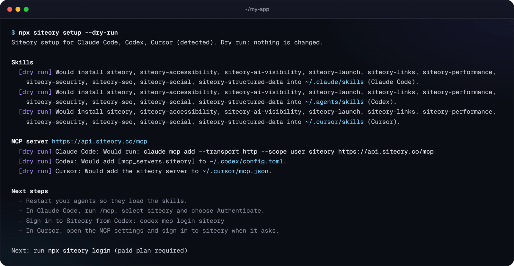

<div align="center">

<picture>
  <source media="(prefers-color-scheme: dark)" srcset="https://raw.githubusercontent.com/cyb3r-vishal/siteory-skills/main/.github/assets/banner-dark.png">
  
</picture>

<br>

[](https://www.npmjs.com/package/siteory)
[](https://nodejs.org)
[](#connect-the-mcp-server-by-hand)
[](#skills)
[](LICENSE)

**[Quick start](#quick-start)** · **[Skills](#skills)** · **[Install](#install)** · **[MCP server](#connect-the-mcp-server-by-hand)** · **[CLI](#use-the-cli)** · **[siteory.co](https://siteory.co)**

</div>

<br>

Siteory checks websites for SEO, AI visibility (AEO/GEO) and security problems and explains how to fix each one. On your own machine it also checks performance, accessibility, structured data, links, social previews and launch readiness. This repository gives coding agents three things:

<table>
  <tr>
    <td width="33%" valign="top">
      <br>
      <b>Agent skills</b><br>
      Ten skills that run the Siteory checker against a local build or a deployed URL, fix the findings in your code by framework, and verify each fix.
    </td>
    <td width="33%" valign="top">
      <br>
      <b>The Siteory MCP server</b><br>
      <code>https://api.siteory.co/mcp</code> for full hosted audits, Markdown reports, rescans and before/after comparisons.
    </td>
    <td width="33%" valign="top">
      <br>
      <b>The <code>siteory</code> CLI</b><br>
      A zero-dependency npm package that runs the checker (<code>npx&nbsp;siteory&nbsp;check</code>) and installs the skills and MCP config into your agents (<code>npx&nbsp;siteory&nbsp;setup</code>).
    </td>
  </tr>
</table>

> [!NOTE]
> Installing the skills, the plugin and the CLI is free. Running the checker and the MCP tools needs a paid Siteory plan: a single audit ($9) or Pro. See [Plans and access](#plans-and-access).

## Quick start

**1. Set up your agents.** One command finds Claude Code, Codex, Cursor, VS Code, Gemini CLI, OpenCode and Windsurf, installs the skills into each and adds the MCP server.

```bash
npx siteory setup
```

Add `--dry-run` to see what would change first:



**2. Sign in once.** This opens your browser. `npx siteory whoami` shows the signed-in account and plan.

```bash
npx siteory login
```

**3. Ask your agent.**

```text
Check http://localhost:3000 with Siteory and fix what you find.
```

The skill runs the checker, fixes each finding in your code and re-checks it. To run the checker yourself:

```bash
npx -y siteory check http://localhost:3000
```

## How it works

<table>
  <tr>
    <td width="25%" valign="top" align="center">
      <br>
      <b>1. Check</b><br>
      <sub>Run the checker on a local production build or a deployed site. Each finding has an id, the evidence and how to fix it.</sub>
    </td>
    <td width="25%" valign="top" align="center">
      <br>
      <b>2. Fix</b><br>
      <sub>Your agent changes the code, following the skill's guide for your framework: Next.js, Astro, Vite, WordPress and more.</sub>
    </td>
    <td width="25%" valign="top" align="center">
      <br>
      <b>3. Verify</b><br>
      <sub>Re-run only that finding by its id. Exit code 0 means it is gone.</sub>
    </td>
    <td width="25%" valign="top" align="center">
      <br>
      <b>4. Ship</b><br>
      <sub>Gate the deploy on every lens before it ships, then rescan the live site and compare the two audits.</sub>
    </td>
  </tr>
</table>

## Skills

Each skill runs the bundled checker, explains the findings, fixes them in your code and verifies every fix.

**Local checker and hosted audit**

<table>
  <tr>
    <td width="64" align="center"></td>
    <td><a href="skills/siteory/SKILL.md"><b><code>siteory</code></b></a><br>The whole loop: local checks, the hosted MCP tools, prioritising, fixing and re-verifying.</td>
  </tr>
  <tr>
    <td width="64" align="center"></td>
    <td><a href="skills/siteory-seo/SKILL.md"><b><code>siteory-seo</code></b></a><br>Titles, descriptions, headings, canonicals, noindex, robots.txt, sitemaps, broken links, alt text, social tags, HTTPS. Fix guides for Next.js, Astro, Vite/React, WordPress, Nuxt, SvelteKit, React Router, Remix and Gatsby.</td>
  </tr>
  <tr>
    <td width="64" align="center"></td>
    <td><a href="skills/siteory-ai-visibility/SKILL.md"><b><code>siteory-ai-visibility</code></b></a><br>AI crawler access in robots.txt, llms.txt, content that needs JavaScript to appear, thin pages, JSON-LD identity.</td>
  </tr>
  <tr>
    <td width="64" align="center"></td>
    <td><a href="skills/siteory-security/SKILL.md"><b><code>siteory-security</code></b></a><br>Security headers (CSP, HSTS, framing, Referrer-Policy, Permissions-Policy), CORS, and secrets leaked into client JavaScript.</td>
  </tr>
</table>

**Local checker only**

These six run lenses that only the local checker has; the hosted audit does not report them. Turn them on by name or with `--lens all` (see [Lenses](#lenses)).

<table>
  <tr>
    <td width="64" align="center"></td>
    <td><a href="skills/siteory-performance/SKILL.md"><b><code>siteory-performance</code></b></a><br>Page weight: HTML, JavaScript and CSS size, render-blocking scripts, oversized or old-format images, missing image dimensions and lazy loading, font-display, third-party scripts, and on deployed sites compression and caching. Guides for next/image, next/font and next/script, Astro, Vite, WordPress and common hosts.</td>
  </tr>
  <tr>
    <td width="64" align="center"></td>
    <td><a href="skills/siteory-accessibility/SKILL.md"><b><code>siteory-accessibility</code></b></a><br>Links and buttons without names, unlabeled form fields, duplicate ids, aria-hidden on focusable elements, positive tabindex, disabled zoom, untitled iframes, vague link text, autoplaying sound; when to use axe or Lighthouse for contrast and keyboard checks.</td>
  </tr>
  <tr>
    <td width="64" align="center"></td>
    <td><a href="skills/siteory-structured-data/SKILL.md"><b><code>siteory-structured-data</code></b></a><br>JSON-LD validation for rich results: required and recommended properties per type, @context, URLs, ISO dates, homepage identity and retired types, with a valid example per type.</td>
  </tr>
  <tr>
    <td width="64" align="center"></td>
    <td><a href="skills/siteory-links/SKILL.md"><b><code>siteory-links</code></b></a><br>Internal redirects, mixed content, localhost and dev-server URLs, preview and staging hosts, broken anchors, internal nofollow, and with <code>--external</code> broken outbound links.</td>
  </tr>
  <tr>
    <td width="64" align="center"></td>
    <td><a href="skills/siteory-social/SKILL.md"><b><code>siteory-social</code></b></a><br>Open Graph and Twitter card tags on every page, and the share image itself: absolute URL, loads, 1200x630, no dev or preview hosts; plus the platform debuggers.</td>
  </tr>
  <tr>
    <td width="64" align="center"></td>
    <td><a href="skills/siteory-launch/SKILL.md"><b><code>siteory-launch</code></b></a><br>The pre-deploy gate: every lens with <code>--fail-on high</code> plus dev-build, soft 404, template text, favicon, manifest, broken assets, sitemap, https and www redirect and source map checks.</td>
  </tr>
</table>

## Install

### Every agent at once

```bash
npx siteory setup             # detect agents in your home directory and set them up
npx siteory setup --dry-run   # show what would change first
npx siteory setup --agent claude-code --agent cursor
npx siteory setup --project   # skills into this project instead of your home directory
```

It supports Claude Code, Codex, Cursor, VS Code, Gemini CLI, OpenCode and Windsurf. For each agent it copies the Siteory skills into the agent's skills folder and adds the MCP server: through `claude mcp add`, `code --add-mcp` and `gemini mcp add` where those CLIs exist, and by merging the agent's JSON or TOML config otherwise.

- It never prompts and never stores secrets.
- Before changing a config file it saves a timestamped backup next to it.
- It leaves a file it cannot parse (for example JSON with comments) untouched and prints the snippet to add yourself.
- `--skills-only` and `--mcp-only` limit what it does.

> [!TIP]
> In Windows PowerShell, use `npx.cmd` if script execution is disabled.

### One agent at a time

<details>
<summary><b>Claude Code plugin</b></summary>

```text
/plugin marketplace add cyb3r-vishal/siteory-skills
/plugin install siteory@siteory
```

Or from a shell: `claude plugin install siteory --marketplace cyb3r-vishal/siteory-skills`. The plugin includes the skills and the MCP server. Run `/mcp`, select `plugin:siteory:siteory` and choose Authenticate. Use either the plugin or a manual `claude mcp add`, not both, or the Siteory tools appear twice.

</details>

<details>
<summary><b>Codex</b></summary>

```bash
codex plugin marketplace add cyb3r-vishal/siteory-skills
codex plugin add siteory@siteory
codex mcp login siteory
```

</details>

<details>
<summary><b>Cursor</b></summary>

Teams can import this repository as a plugin marketplace under Dashboard > Plugins & MCPs > Add Marketplace. On a single machine, `npx siteory setup --agent cursor` installs the skills and the MCP config.

</details>

<details>
<summary><b>Gemini CLI</b></summary>

```bash
gemini extensions install https://github.com/cyb3r-vishal/siteory-skills
```

Then run `/mcp auth siteory` in Gemini CLI.

</details>

<details>
<summary><b>Skills only, for any agent</b> (<code>npx skills add</code>)</summary>

```bash
npx skills add cyb3r-vishal/siteory-skills
```

The open `skills` CLI installs into every agent it detects. It needs Node.js 22.20 or later. Add the MCP server separately (see below) if you want hosted audits.

</details>

## Connect the MCP server by hand

Sign-in is OAuth in your browser; there is no API key. You can see and revoke connected apps in Siteory under Settings > Connected apps. `npx siteory mcp` prints all of these, and `npx siteory mcp --client <id>` prints one.

<details>
<summary><b>Claude Code</b></summary>

```bash
claude mcp add --transport http --scope user siteory https://api.siteory.co/mcp
```

Then run `/mcp`, select siteory and choose Authenticate.

</details>

<details>
<summary><b>claude.ai, Claude Desktop and Cowork</b></summary>

Customize > Connectors > Add custom connector, URL `https://api.siteory.co/mcp`. On Team and Enterprise plans an owner adds it under Organization settings > Connectors.

</details>

<details>
<summary><b>Cursor</b></summary>

In `~/.cursor/mcp.json`, or `.cursor/mcp.json` in a project:

```json
{ "mcpServers": { "siteory": { "url": "https://api.siteory.co/mcp" } } }
```

</details>

<details>
<summary><b>VS Code</b></summary>

Run "MCP: Open User Configuration", or use `.vscode/mcp.json` in a project:

```json
{ "servers": { "siteory": { "type": "http", "url": "https://api.siteory.co/mcp" } } }
```

</details>

<details>
<summary><b>Codex</b></summary>

In `~/.codex/config.toml`, then run `codex mcp login siteory`:

```toml
[mcp_servers.siteory]
url = "https://api.siteory.co/mcp"
```

</details>

<details>
<summary><b>ChatGPT</b></summary>

Plugins > + > Add custom MCP server, URL `https://api.siteory.co/mcp`, authentication OAuth. Custom MCP servers need developer mode on a plan that offers it.

</details>

<details>
<summary><b>Gemini CLI</b></summary>

In `~/.gemini/settings.json`, then run `/mcp auth siteory`:

```json
{ "mcpServers": { "siteory": { "httpUrl": "https://api.siteory.co/mcp" } } }
```

</details>

<details>
<summary><b>Antigravity</b></summary>

In `~/.gemini/config/mcp_config.json`:

```json
{ "mcpServers": { "siteory": { "serverUrl": "https://api.siteory.co/mcp" } } }
```

</details>

<details>
<summary><b>OpenCode</b></summary>

In `~/.config/opencode/opencode.json`, then run `opencode mcp auth siteory`:

```json
{ "$schema": "https://opencode.ai/config.json", "mcp": { "siteory": { "type": "remote", "url": "https://api.siteory.co/mcp", "enabled": true } } }
```

</details>

<details>
<summary><b>Windsurf</b></summary>

In `~/.codeium/windsurf/mcp_config.json`:

```json
{ "mcpServers": { "siteory": { "serverUrl": "https://api.siteory.co/mcp" } } }
```

</details>

<details>
<summary><b>Clients without remote servers</b></summary>

Bridge through `mcp-remote`:

```json
{ "mcpServers": { "siteory": { "command": "npx", "args": ["-y", "mcp-remote", "https://api.siteory.co/mcp"] } } }
```

</details>

### MCP tools

| Tool | What it does |
|---|---|
| `quick_audit` | Free preview: SEO, AI visibility and a passive security snapshot. Uses no credit. |
| `start_audit` | Full audit of a public site. Uses your free full audit or one credit. |
| `get_audit` | Progress, scores and issue counts. Can wait up to 25 seconds per call. |
| `list_audits` | Your recent audits, newest first. |
| `list_issues` | Issues in priority order, filtered by lens and severity. |
| `get_issue` | One issue with its evidence, a fix prompt and the command that verifies the fix locally. |
| `get_report` | The audit as a Markdown report: prioritized, summary, or one lens. |
| `rescan` | A new full audit of the same URL and lenses, for after you deploy. Uses a credit. |
| `compare_audits` | Before and after: resolved, introduced and still-open issues. |
| `get_account` | Your plan, credit balance and whether the free full audit is still available. |

Details: [skills/siteory/references/mcp-tools.md](skills/siteory/references/mcp-tools.md).

## Use the CLI

```bash
# Sign in once (paid plan required)
npx siteory login

# Human-readable summary
npx -y siteory check http://localhost:3000

# JSON (schema siteory.local/1)
npx -y siteory check https://example.com --lens seo,aeo --json

# Re-verify one fix
npx -y siteory check http://localhost:3000 --only seo_missing_h1 --fail-on info

# Local-only lenses
npx -y siteory check http://localhost:3000 --lens performance,accessibility --json

# Pre-deploy gate
npx -y siteory check http://localhost:3000 --lens all --prod https://www.example.com --fail-on high

# Also request outbound links and share images
npx -y siteory check https://www.example.com --lens links,social --external
```

Check a production build (`next build && next start`, `astro build && astro preview`, `vite build && vite preview`), not the dev server. `--prod https://www.example.com` judges host-dependent checks such as canonical hosts against your production hostname; for a local target it also maps production URLs to the local server. `npx siteory check --help` lists every option.

### Lenses

Without `--lens`, the checker runs the hosted audit's lenses. The other six run only locally and only when you name them. `--lens all` runs all ten, and each local-only lens adds its own score to `scores`.

| Lens | Aliases | When it runs |
|---|---|---|
| `seo` | | By default, here and in the hosted audit |
| `aeo` | `ai` | By default, here and in the hosted audit |
| `security` | | By default, here and in the hosted audit |
| `foundations` | | By default, here and in the hosted audit |
| `performance` | `perf` | Locally, when named |
| `accessibility` | `a11y` | Locally, when named |
| `schema` | `structured-data`, `jsonld` | Locally, when named |
| `links` | | Locally, when named |
| `social` | `og` | Locally, when named |
| `launch` | | Locally, when named |

`--external` lets the links and social lenses request third-party URLs (at most 100, 10 per host, never private addresses); without it those checks are skipped.

### Re-verify a fix

Repeat the first run's `--prod`, `--external`, `--max-pages`, `--depth` and `--lens` flags with `--only <id> --fail-on info`, or use the `Verify locally:` line at the end of the finding's fix prompt.

- An `--only` id of a local-only lens (`perf_`, `a11y_`, `schema_`, `links_`, `social_`, `launch_`) turns its lens on by itself.
- Exit 0 counts only if the earlier run reported that id and this run does not list it under Skipped. An `--only` id that the run skips exits 2.
- For a leaked secret, run the whole `--lens security --fail-on high` check instead, because a rotated or different secret gets a new id.

### Exit codes

| Code | Meaning |
|:-:|---|
| `0` | Ran; nothing at or above the `--fail-on` threshold |
| `1` | A finding at or above the threshold remains |
| `2` | Usage error, or an `--only` id that this run skips |
| `3` | The start page could not be read |
| `4` | Internal error |
| `5` | Not signed in, or the account has no paid plan |

### In CI

Not yet: the checker signs in through a browser on your own machine, so a CI runner cannot sign in. Run the gate locally before you deploy; CI sign-in tokens are planned.

## What runs where

| | Local checker (`siteory check`, the skills) | Hosted audit (MCP tools, siteory.co) |
|---|---|---|
| **Runs on** | Your machine | Siteory's servers |
| **Targets** | localhost, private networks, deployed sites | Public sites only |
| **SEO and AI visibility checks** | Same engine, ids and thresholds as the hosted audit | Yes |
| **Security** | Passive: response headers, CORS, secrets in client JavaScript | Passive plus active checks, verifiers, Supabase row-level security and exposure data |
| **Performance, accessibility, structured data, links, social previews, launch checks** | Yes, as opt-in lenses | No |
| **History, reports, comparisons** | No | Yes |
| **Account or credits** | A paid Siteory plan and `npx siteory login`; no credits used | The MCP tools need a paid Siteory plan. Previews are free; full audits use your free audit or credits |

## Plans and access

Siteory MCP, the agent skills and the local checker are part of paid Siteory plans: a single audit ($9) or Pro. The free audit on siteory.co does not include them. See [pricing](https://siteory.co/pricing).

- Anyone can install the skills, the plugin and the CLI. Running the checker needs a paid plan and a sign-in on each machine that runs it: `npx siteory login` opens your browser once. `npx siteory whoami` shows the signed-in account and plan, and `npx siteory logout` signs out.
- The MCP server signs you in through your agent (OAuth in the browser). A free account is asked to upgrade instead of connecting.
- Exit code 5 from the CLI means this machine is not signed in or the account has no paid plan.
- The sign-in only confirms your plan. Checks still run on your machine and send nothing about the sites you check to Siteory.

## Privacy and safety

- **Local checks stay local.** The local checker sends nothing about the sites you check to Siteory; it contacts Siteory only to sign you in and confirm your plan.
- **GET requests only.** It requests only the site you name: pages on the same origin, robots.txt, sitemaps, llms.txt, and the scripts, stylesheets, images, manifests and source maps those pages reference. The launch lens adds one request to a random unknown path (to see whether it returns 404), `/favicon.ico` when no icon is linked, and on deployed sites the `http://` and www or apex versions of the start URL. Only with `--external` does it request third-party URLs that your pages link to, and never private network addresses. It never signs in to that site, submits forms, fuzzes parameters or probes admin paths.
- **Unsafe targets are refused.** It refuses URLs with credentials, link-local addresses and cloud metadata hosts, even when an agent asks.
- **Secrets are never printed.** Secrets found in client JavaScript are reported as type and fingerprint.
- **Setup touches only Siteory entries.** `siteory setup` writes only skill folders named `siteory*` and the `siteory` entry in each agent's MCP config, after backing up the file. It stores no tokens: each agent keeps its own OAuth tokens.
- **Your sign-in stays on your machine.** `npx siteory login` saves the checker's sign-in in `~/.siteory/credentials.json`, readable only by you where the system supports it. `npx siteory logout` revokes it and deletes the file.
- **Hosted audits live in your account.** They run on Siteory's servers and are stored in your Siteory account. See the [privacy policy](https://siteory.co/privacy) and [terms](https://siteory.co/terms).
- **Only audit sites you own or are allowed to test.**

## Development

```bash
npm test                   # node --test
npm run validate           # skill frontmatter and file checks
npm run vendor             # copy the engine bundle from ../siteory-api/dist-cli/siteory.mjs
npm run vendor -- --from <path/to/siteory.mjs>
claude plugin validate . --strict
npm pack --dry-run
```

The check engine is built in the Siteory API repository (`npm run build:cli`) and vendored into `cli/engine.mjs` and every `skills/*/scripts/siteory.mjs`, so the npm package and each skill run the same version.

## License

Proprietary. Anyone may install the skills and the CLI; running the Siteory checker requires an active paid Siteory plan. You may not redistribute or modify the bundled checker. See [LICENSE](LICENSE) and the [terms](https://siteory.co/terms).

<br>

<p align="center">
  <a href="https://siteory.co"></a>
  <br>
  <sub><a href="https://siteory.co">siteory.co</a> · <a href="https://siteory.co/pricing">Pricing</a> · <a href="https://siteory.co/privacy">Privacy</a> · <a href="https://siteory.co/terms">Terms</a></sub>
</p>
